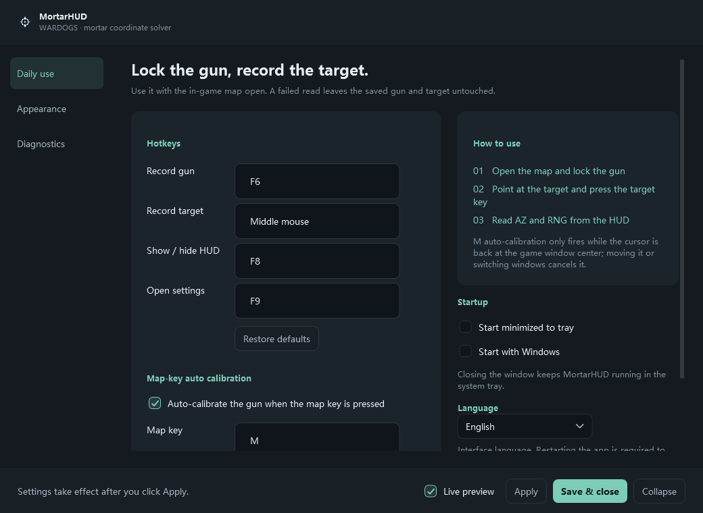

<div align="center">


# MortarHUD

**An external HUD that solves mortar coordinates for *Wardogs***

[](https://github.com/Cec1c/MortarHUD/actions/workflows/ci.yml)
[](https://dotnet.microsoft.com/)
[](#project-layout)
[](https://github.com/shimat/opencvsharp)
[](https://github.com/tesseract-ocr/tesseract)
[](#testing)
[](#requirements)

Reads gun and target coordinates from the game map and displays bearing and range in a click-through overlay, with a sight ruler that can be calibrated for each resolution.

**English** ｜ [中文](README.zh-CN.md)

[Quick start](#quick-start) ｜ [In game](#in-game) ｜ [UI](#ui) ｜ [OCR](#ocr) ｜ [Project layout](#project-layout) ｜ [Known limits](#known-limits)

</div>

## What it does

Open the map in *Wardogs* and point at any spot — the game shows the absolute coordinates of that point next to your cursor. MortarHUD reads those two lines and works out the bearing and range from your mortar to the target.

```text
input (game screen)     output (HUD)
y109.78                 AZ  079.0°
x98.09                  RNG 152m
```

Because it reads *absolute* coordinates, zooming, panning and re-centering the map make no difference. Once the gun position is locked it stays valid even after your own map marker disappears — which happens as soon as you get on a mortar.

### How it runs

The app runs as a normal user, observes global hotkeys, captures screen pixels, and performs OCR and coordinate calculations locally. It makes no network requests, injects no code, reads or writes no game memory, and sends no simulated input. The HUD and ruler provide visual references; the player aims and fires. Wind correction, enemy detection, and game-ballistics simulation are outside its scope.

## In game

Four captures on the same map, the cursor moved to a different spot each time:

| | |
| --- | --- |
|  |  |
|  |  |

Bearing and range come out as 182.3° / 150 m, 232.0° / 174 m, 303.2° / 155 m and 009.8° / 146 m. The `y` / `x` lines beside the map cursor are what the OCR reads; the green block on the left is the HUD, and the panel in the bottom-right corner is the optional diagnostics readout.

## UI



Four pages: Daily use / Appearance / Sight ruler / Diagnostics. Hotkeys, HUD size and position are expanded by default; font effects and engine paths are tucked into collapsible sections.

The interface ships in Chinese and English. On first launch it picks one from your system language (Chinese systems get Chinese, everything else gets English); you can change it later under **Daily use → Language**, and it takes effect after a restart.

## Quick start

### Requirements

**Windows x64.** Download the portable build from [Releases](https://github.com/Cec1c/MortarHUD/releases), extract it, and run `MortarHUD.exe`. The portable build includes the .NET runtime. Building from source requires the **.NET 10 SDK**; see [Development](#development).

First run:

```text
1. Start the app; closing the settings window leaves it in the system tray
2. Open the in-game map, move the cursor onto your mortar, press F6
3. Move the cursor onto the target, press the middle mouse button
4. Repeat step 3 for each new target
```

| Hotkey | Action |
| --- | --- |
| `F6` | Record gun position |
| `Middle mouse` | Record target |
| `F8` | Show / hide HUD and ruler |
| `F9` | Open settings |
| `F10` | Show / hide the ruler independently |

Capture, HUD, and settings hotkeys can be rebound. Target capture uses the middle mouse button by default to reduce conflicts with the game's function keys; F10 controls the ruler.

A failed read keeps the previous target. The HUD reports recognition and capture failures, such as "Map not open" or "Cursor moved, cancelled".

### Auto-calibration with the map key

Pressing **M** in game opens the map and the cursor is re-centered on your own position, so pressing M is equivalent to putting the cursor on the mortar.

The app observes M through Raw Input, so the game still receives the key. By default it waits 150 ms, freezes four frames 60 ms apart, then runs OCR on those frames. Two adjacent frames must agree before the gun position is locked. Existing custom delays are retained.

After pressing M, keep the cursor at the center for about 0.4 seconds. Capture requires a centered cursor and an unchanged foreground window; you can move the cursor once the burst finishes. Clicking, scrolling, keyboard input, a new capture, or switching windows cancels the operation. Failure preserves the previous gun and target positions.

> [!TIP]
> The first time you use it, open **Diagnostics → Inspect a single recognition** and click the test button. It shows the captured image, the preprocessed result and the raw text from every pipeline, which immediately tells you whether the ROI is framing the coordinates.

### Sight ruler

After recording a target, enable the ruler under **Settings → Sight ruler** and apply the change. In the mortar sight view, adjust the gun until the game's distance marks line up with the matching external marks. Their positions are interpolated from the current RNG.

The default calibration comes from L81 MORTAR screenshots at 1920×1080 and covers 80–684 m. Each resolution can store its own horizontal position, reticle center height, and 50 MIL spacing. Unconfigured resolutions get a height-scaled initial estimate and a visible notice. Recalibrate after changing FOV, weapon, or sight zoom. Positioning and interpolation have offline checks; actual impact points still need in-game validation. See the [September 22 acceptance record](docs/2026-09-22-acceptance.md) for steps, calibration values, and results.

## Coordinate system and solving

```text
+X = East            +Y = North
1 coordinate unit ≈ 100 m
Bearing: North = 0°, East = 90°, South = 180°, West = 270°

dx = Xtarget − Xgun
dy = Ytarget − Ygun

RNG = √(dx² + dy²) × metersPerUnit
AZ  = atan2(dx, dy) in degrees, normalized to [0, 360)
```

Note the argument order of `atan2` is **(east, north)**, the opposite of the usual `(y, x)`; unit tests covering all eight directions pin this down. Everything here is configurable.

## OCR

Auto reads the coordinate lines using **C / C-Balanced preprocessing × Tesseract PSM 6 / 11**. All valid readings must agree, then the combined confidence is checked. Conflicting valid coordinates fail the capture.

```bash
dotnet run --project tools/MortarHUD.Benchmark     # writes docs/ocr-benchmark.md
```

Earlier baseline (3 real screenshots, using the Auto configuration at the time; timings are historical):

| Configuration | Accuracy | Average time |
| --- | --- | --- |
| **Auto at the time** | **3/3** | ~163 ms |
| Tesseract + pipeline C | 3/3 | ~55 ms |

In captured samples, PSM 6 read 99.73 as 99.75, while PSM 11 read 110.07 as 0.07. Cross-checking detects such disagreements. The 54 ROI regression cases added on September 22 cover clear coordinates, occlusion, and ambiguous frames; see [Testing](#testing).

The default ROI is `offset(5, −74)`, `100×96` — the text block measured from real "full screen + cursor position" sampling, plus 12 px of margin. It scales with screen height relative to 1080p.

| Setting | Default |
| --- | --- |
| Engine / preprocessing | Auto (C / C-Balanced × PSM 6 / 11) |
| Coordinate range | 0 – 200 |
| Minimum confidence | 0.60 |
| Require a decimal point | on |

MortarHUD combines format checks, agreement, and the engine score. Tesseract can report 0.00 even for correctly read coordinates, so its score contributes one part of the total:

```text
0.55  (format and range validation passed)
+ 0.25 × (agreeing readings / total readings)
+ 0.20 × (engine's own confidence)
```

The threshold is checked after aggregation. For example, if all readings agree and their engine scores are zero, the total is 0.80; a threshold of 0.9 rejects that result. The engine term uses the highest score among agreeing readings.

Keep "require a decimal point" enabled. Disabling it lets a misreading of `98.09` as `98` pass the format check; at the default scale, that is a 9-metre error on that axis.

### Template engine

A fallback for when the language data is missing. Its glyph library is learned from real screenshots and covers `x y . 0 1 2 3 4 5 6 7 8 9`. Unknown glyphs are reported as `?`, which makes the parser reject the capture.

Regenerate it from the built-in baseline screenshots:

```bash
dotnet run --project tools/MortarHUD.Benchmark -- --gen-templates
```

The baseline set is only three screenshots, and its coordinates happen not to contain a `2` or a `3`. So the library is instead generated from the captures in `%AppData%\MortarHUD\Debug\` (Settings → enable capture), which carry their own labels: each record stores the coordinate that was read, so the text on screen is known and the glyphs can be labelled automatically — no manual bounding boxes.

```bash
dotnet run --project tools/MortarHUD.Benchmark -- --gen-from-debug
```

Add `--debug-dir <path>` to read captures from somewhere else. Only captures whose coordinate was read successfully are used. The captures themselves are not committed — regenerate the library from your own, and the coverage test below will tell you if anything is missing.

## Configuration

```text
%AppData%\MortarHUD\
├─ settings.json      # main settings (with schemaVersion)
├─ Themes\            # custom HUD themes, one JSON per theme
├─ Logs\              # one file per day, pruned after 14 days
└─ Debug\             # dumped ROIs and results (off by default)
```

The HUD can be adjusted in layout (Minimal / Compact / Detailed / Horizontal), font family, size and weight, letter and line spacing, seven colours, outline, shadow and background panel, opacity, anchor and offset, which fields to show, and decimal places. Position is either an anchor plus offset, or tick "unlock HUD position" and drag it directly.

Four built-in themes: Default Green, Tactical White, Amber, High Contrast. Built-in themes cannot be edited or deleted — use "Save as" to fork one into a custom theme, and themes can be imported and exported.

## Project layout

```text
src/
├─ MortarHUD.Localization/       # UI strings (zh / en), no dependencies
│
├─ MortarHUD.Core/               # pure logic, no Windows or UI dependency
│  ├─ Models/ Ballistics/ Parsing/ Validation/
│  ├─ Session/                   # state machine, HUD layout, operation scheduling
│  ├─ Configuration/ Themes/     # settings and themes
│  └─ Diagnostics/               # file logging
│
├─ MortarHUD.Capture/            # capture → preprocess → OCR
│  ├─ ScreenCapture/             # GDI capture + ROI maths
│  ├─ ImageProcessing/           # pipelines A / B / C
│  └─ Ocr/                       # engine interface, Tesseract, template matching, cross-validation
│
├─ MortarHUD.Platform.Windows/   # Win32 interop
│  ├─ Hotkeys/                   # Raw Input listeners
│  ├─ Mouse/ WindowStyles/ Dpi/ Startup/
│
└─ MortarHUD.App/                # WPF
   ├─ Views/ ViewModels/ Services/ Tray/
   ├─ Localization/              # XAML markup extension for the string table
   ├─ Assets/                    # application icon
   └─ Models/                    # OCR resources shipped with the app

tests/                           # Core.Tests / Ocr.Tests / Fixtures
tools/MortarHUD.Benchmark/       # benchmark + glyph template generation
```

The layers are decoupled: `Capture ≠ OCR ≠ Parser ≠ Calculator ≠ Overlay`, and each can be replaced and tested on its own. OCR engines sit behind `ICoordinateOcrEngine`, preprocessing behind `IImagePreprocessor`.

## Testing

```bash
dotnet test MortarHUD.sln
```

The [2026-09-22 acceptance record](docs/2026-09-22-acceptance.md) reports 277/277 tests passing (243 Core + 34 OCR). Among 54 added real ROI cases, 32 clear coordinates were read correctly, 18 occluded or coordinate-free images were rejected, and 4 earlier ambiguous samples were read correctly or rejected.

Coverage includes all eight solving directions and the `[0, 360)` boundary, the formats the parser must accept and must reject, state-machine semantics (no solving without a gun position, a failed OCR never corrupts the target), ROI scaling and negative multi-monitor origins, end-to-end OCR on three real screenshots, preprocessing polarity, and settings/theme round-trips.

The self-test walks the full startup path (constructs every window and runs one real recognition) without showing windows, registering hotkeys or capturing the screen:

```bash
dist\MortarHUD\MortarHUD.exe --selftest        # exit code 0 means it passed
```

An incorrect recognition returns a non-zero self-test exit code.

## Distribution

| Mode | Command | Size | Runtime needed on target |
| --- | --- | --- | --- |
| **Single-file portable** (default) | `publish.cmd` | ~95 MB | nothing |
| Self-contained folder | `publish.cmd folder` | ~227 MB | nothing |
| Framework-dependent | `publish.cmd runtime` | ~60 MB | .NET 10 desktop runtime |

Output goes to `dist\MortarHUD-next-<mode>\`; a non-empty directory is refused so old and new DLLs never get mixed. The portable build packs the app and its resources into one EXE: `Models\` (OCR language data and glyph library) is packed inside too and extracted to `%TEMP%\.net\` at runtime. Most of the size is the .NET runtime and `OpenCvSharpExtern.dll` (59 MB); the project's own four DLLs add up to under 0.5 MB. Getting down to 95 MB takes single-file compression plus dropping OpenCV's FFmpeg plugin and Tesseract's x86 libraries.

> [!NOTE]
> Single-file mode has to extract the native libraries to `%TEMP%\.net\` before loading them, so it starts a little slower than folder mode — and a smaller download does not mean less disk usage. Use `folder` if startup time matters.

## Known limits

The following still need checks in the actual game environment:

- Whether the overlay is genuinely always-on-top, click-through, and does not steal focus — plus Alt+Tab behaviour
- Position and ROI at 100% / 125% / 150% / 200% DPI
- Multiple monitors
- Windowed / borderless windowed / exclusive fullscreen
- Whether the hotkeys clash with the game's own bindings

> [!IMPORTANT]
> **Use borderless windowed mode.** In exclusive fullscreen, the HUD may be invisible or screen capture may fail.

Distribution uses portable builds. Auto falls back to the template engine when Tesseract is unavailable. The default ROI was measured at 1080p; if your game UI scale differs substantially, adjust it via **Diagnostics → Inspect a single recognition**.

## Development

Build from source with the .NET 10 SDK:

```bash
dotnet build MortarHUD.sln -c Release
dotnet test MortarHUD.sln
publish.cmd                     # self-contained; end users need no runtime
```

Adding a preprocessing pipeline: implement `IImagePreprocessor`, return a single-channel "black text on white" `Mat`, and register it in `PreprocessorFactory.All`. Only consider adding it to `AutoCandidates` once the benchmark likes it — every extra pipeline costs `Auto` about 40 ms and the end-to-end target is under 100 ms.

Adding an OCR engine: implement `ICoordinateOcrEngine`. An engine only fills in `RawText` and `Confidence`; leave `X`/`Y` empty and let `CoordinateTextParser` do the numeric parsing.

To debug OCR, export the preprocessed images and check whether text is intact and background noise has been removed:

```bash
dotnet run --project tools/MortarHUD.Benchmark -- --dump ./_analysis/processed
```

This writes the binarized output of every pipeline on every fixture as a PNG. Compare those images with the raw text and recognition results.

The same facilities are in the app under **Diagnostics**: "Inspect a single recognition" shows the raw image, the preprocessed images, and each pipeline's text and timing; "Collect the next 10 captures" dumps raw ROIs, preprocessed images and result JSON, then stops automatically — that is the tool for intermittent failures.

Logs live in `%AppData%\MortarHUD\Logs\yyyy-MM-dd.log` and record startup, shutdown, hotkeys, captures, raw OCR output, validation failures and exceptions.

> [!NOTE]
> Picking up development? Read **[AGENTS.md](AGENTS.md)** first — environment gotchas, architecture, and the traps already stepped on are all in there.

## Community

QQ group (Chinese) **2166037429** — questions, screenshots of failed reads, feature requests.

When reporting a recognition problem, include the logs from `%AppData%\MortarHUD\Logs\` and the files produced by **Diagnostics -> Collect the next 10 captures**; it saves a lot of back and forth.

---

## License

[Apache-2.0](LICENSE) © 2026 Cec1c
