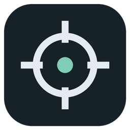
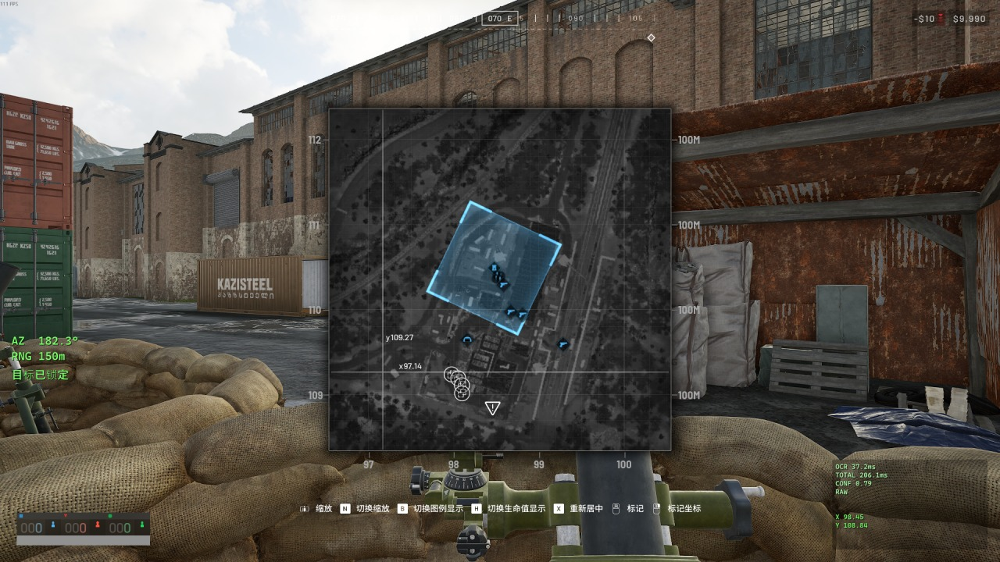
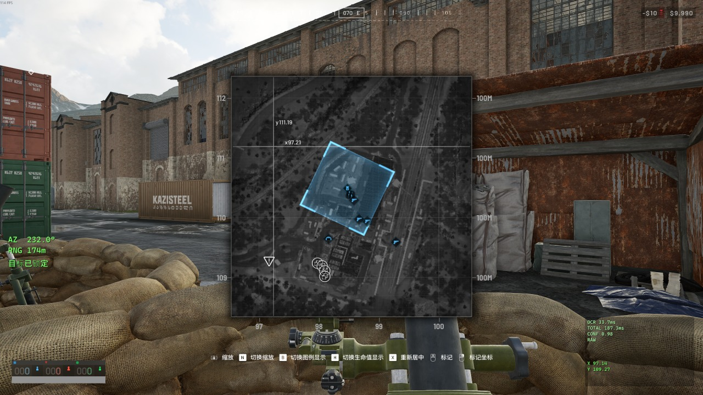
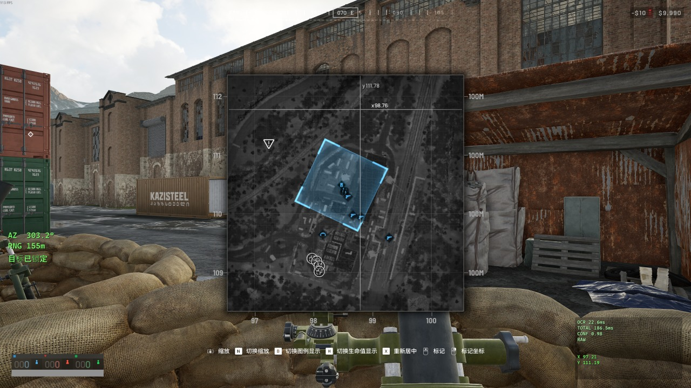
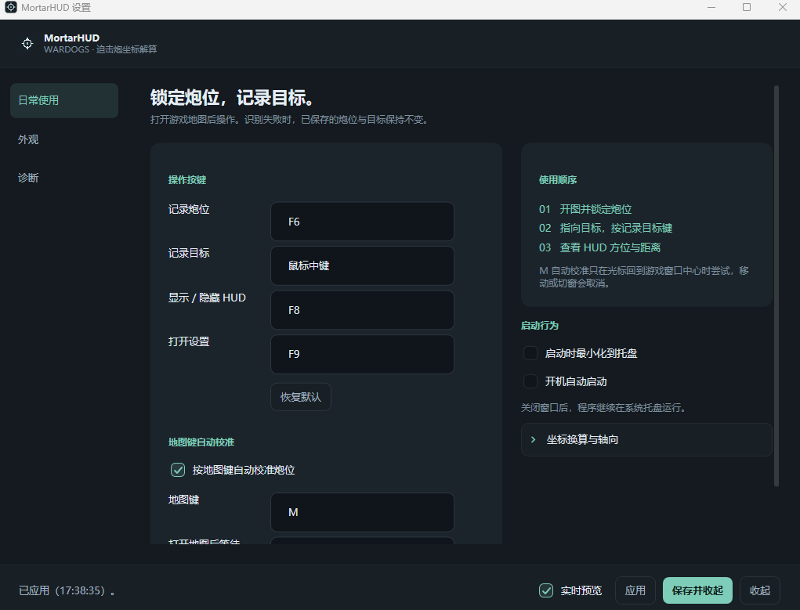

<div align="center">



# MortarHUD

**《Wardogs》迫击炮坐标解算外置 HUD**

[](https://github.com/Cec1c/MortarHUD/actions/workflows/ci.yml)
[](https://dotnet.microsoft.com/)
[](#项目结构)
[](https://github.com/shimat/opencvsharp)
[](https://github.com/tesseract-ocr/tesseract)
[](#测试)
[](#环境要求)

从游戏地图读取炮位与目标坐标，在透明置顶 HUD 中显示方位角与距离，并提供可按分辨率校准的炮口标尺。

**中文** ｜ [English](README.md)

[快速开始](#快速开始) ｜ [实机效果](#实机效果) ｜ [界面](#界面) ｜ [OCR](#ocr) ｜ [项目结构](#项目结构) ｜ [已知边界](#已知边界)

</div>

## 它做什么

《Wardogs》打开地图后，鼠标指向任意位置，游戏会在光标旁显示该点的绝对坐标。MortarHUD 读出这两行，算出炮位到目标的方位角与距离。

```text
输入（游戏画面）        输出（HUD）
y109.78                AZ  079.0°
x98.09                 RNG 152m
```

读的是绝对坐标，所以地图缩放、平移、重新居中都不影响结果。炮位锁定后即使自己的地图箭头消失（进入迫击炮后常见），已保存的炮位依然有效。

### 运行方式

程序以普通用户权限运行，监听全局热键、截取屏幕像素，并在本地完成 OCR 与坐标解算；不联网、不注入进程、不读写游戏内存，也不模拟键鼠输入。HUD 与标尺用于辅助读数，瞄准和发射由玩家操作；风偏、敌人识别和游戏弹道模拟均不在功能范围内。

## 实机效果

同一张地图上四次采集，每次光标落在不同位置：

| | |
| --- | --- |
|  |  |
|  |  |

解算出的方位角与距离分别是 182.3° / 150 m、232.0° / 174 m、303.2° / 155 m、009.8° / 146 m。地图光标旁那两行 `y` / `x` 就是 OCR 读的内容；左侧绿色那块是 HUD，右下角面板是可选的诊断读数。

## 界面



四页：日常使用 / 外观 / 炮口标尺 / 诊断。键位、HUD 大小与位置默认展开，字体特效、引擎路径这类收在折叠项里。

**界面中英双语**。首次启动按系统语言选（中文系统用中文，其余用英文），之后可在设置 → 日常使用 → 语言里改，重启生效。

## 快速开始

### 环境要求

支持 **Windows x64**。从 [Release](https://github.com/Cec1c/MortarHUD/releases) 下载便携版，解压后双击 `MortarHUD.exe`；便携版已包含 .NET 运行时。从源码构建需要 **.NET 10 SDK**，命令见[开发](#开发)。

首次使用：

```text
1. 启动程序，关掉设置窗口后它留在系统托盘
2. 打开游戏地图，鼠标移到炮位，按 F6
3. 鼠标移到目标，按鼠标中键
4. 换目标重复第 3 步
```

| 热键 | 作用 |
| --- | --- |
| `F6` | 记录炮位 |
| `鼠标中键` | 记录目标 |
| `F8` | 显示 / 隐藏 HUD 与标尺 |
| `F9` | 打开设置 |
| `F10` | 单独显示 / 隐藏标尺 |

采集、HUD 和设置热键可在设置里改。记录目标默认用中键，以减少与游戏功能键的冲突；F10 控制标尺。

识别失败时保留上一个目标，HUD 显示失败或取消原因，例如「地图没打开」「光标移动，已取消」。

### 按 M 自动校准

游戏里按 **M** 开地图时鼠标会复位到屏幕中心，也就是自己所在的位置，所以按 M 等价于把光标移到炮位上。

程序通过 Raw Input 观察 M 键，游戏仍能收到按键。默认等待 150ms 后，每隔 60ms 冻结一帧，共 4 帧，再对已有画面做 OCR；相邻两帧读数一致才锁定炮位。已有自定义等待时间会保留。

按 M 后让光标在中心短暂停留约 0.4 秒。截图要求光标回到前台窗口中心且前台未变化；连拍结束后可移动光标。点击、滚轮、键盘操作、新采集或切窗会取消本轮，失败时保留原炮位与目标。

> [!TIP]
> 第一次用建议先开**诊断 → 查看单次识别结果**，点一次「对当前光标位置测试一次」。它会显示实际截到的图、预处理结果和每条流水线的原始文本，能立刻看出 ROI 有没有框住坐标。

### 炮口标尺

记录目标后，在 **设置 → 炮口标尺** 中启用标尺并应用。进入迫击炮瞄准视图，调整炮口，使游戏距离刻线与外置标尺的同名刻线重合；标尺根据当前 RNG 插值显示位置。

默认标定来自 1920×1080 的 L81 MORTAR 截图，适用距离为 80–684m。其他分辨率可单独保存横坐标、准星中心高度和 50 MIL 间距；未配置时按画面高度给出初值并显示提示。改变 FOV、武器或瞄准缩放后需要重新标定。标尺定位与插值已有离线检查，实际落点仍需实机验收。步骤、刻度表与验证记录见 [9 月 22 日验收文档](docs/2026-09-22-acceptance.md)。

## 坐标系与解算

```text
+X = 东（East）      +Y = 北（North）
1 坐标单位 ≈ 100 米
方位角：北 = 0°，东 = 90°，南 = 180°，西 = 270°

dx = X目标 − X炮位
dy = Y目标 − Y炮位

RNG = √(dx² + dy²) × 每单位米数
AZ  = atan2(dx, dy) 转角度，归一到 [0, 360)
```

`atan2` 的参数顺序是 **(东分量, 北分量)**，和常见的 `(y, x)` 相反，有覆盖八个方向的单元测试钉住。全部可配置。

## OCR

Auto 使用 **C / C-Balanced 两套预处理 × Tesseract PSM 6 / 11 两种分页模式**读取光标附近的坐标。全部有效读数必须一致，再检查汇总置信度；有效坐标发生冲突时，本次识别失败。

```bash
dotnet run --project tools/MortarHUD.Benchmark     # 生成 docs/ocr-benchmark.md
```

早期基准（3 张实机截图，使用当时的 Auto 配置；历史耗时供参考）：

| 配置 | 正确率 | 平均耗时 |
| --- | --- | --- |
| **当时的 Auto** | **3/3** | ~163 ms |
| Tesseract + 流水线 C | 3/3 | ~55 ms |

实机样本中，PSM 6 曾把 99.73 读成 99.75，PSM 11 曾把 110.07 读成 0.07。交叉校验用于发现这些读数分歧。9 月 22 日新增的 54 张 ROI 回归覆盖清晰坐标、遮挡与歧义画面，结果见[测试](#测试)。

ROI 默认值 `offset(5, −74)`、`100×96`，是拿实机「整屏 + 光标位置」同刻采样量出来的文字块外围 +12px。不同分辨率按屏幕高度相对 1080 自动缩放。

| 设置项 | 默认值 |
| --- | --- |
| 引擎 / 预处理 | Auto（C / C-Balanced × PSM 6 / 11） |
| 坐标范围 | 0 – 200 |
| 最低置信度 | 0.60 |
| 必须识别出小数点 | 开 |

程序结合格式、读数一致性与引擎得分计算置信度。实测 Tesseract 对正确坐标也可能给出 0.00，因此引擎分数作为其中一项：

```text
0.55（格式与范围校验通过）
+ 0.25 ×（一致读数 / 总读数）
+ 0.20 ×（引擎自报置信度）
```

汇总后再与门槛比较。例如所有读数一致、引擎得分为 0 时，总分是 0.80；门槛设为 0.9 会拒绝这类结果。引擎项采用一致读数中的最高分。

保持「必须识别出小数点」开启。关闭后，`98.09` 误读为 `98` 也会通过格式检查；按默认比例，该轴相差 9 米。

### 模板引擎

语言包缺失时的兜底，字形库从实机截图里自动学出来，覆盖 `x y . 0 1 2 3 4 5 6 7 8 9`。未识别字形输出 `?`，由解析器将本次采集判为失败。

只用仓库里那三张基准截图生成的话，它们的坐标恰好不含 `2` 和 `3`：

```bash
dotnet run --project tools/MortarHUD.Benchmark -- --gen-templates
```

所以字形库实际是从 `%AppData%\MortarHUD\Debug\` 里的采集记录生成的（设置里打开采集）。这些记录**自带标注**——每条都存了当时识别出的坐标，等于知道屏幕上写的是什么，字形就能自动贴上标签，不用人工量包围盒：

```bash
dotnet run --project tools/MortarHUD.Benchmark -- --gen-from-debug
```

加 `--debug-dir <目录>` 可以指定别的采集目录。只有识别成功的记录会被采用。采集记录本身不入仓库，用自己的重跑一遍即可；缺了哪个字符，下面的覆盖测试会直接报出来。

## 配置

```text
%AppData%\MortarHUD\
├─ settings.json      # 主设置（带 schemaVersion）
├─ Themes\            # 自定义 HUD 主题，每个主题一个 JSON
├─ Logs\              # 按天分文件，自动清理 14 天前
└─ Debug\             # 转储的 ROI 与识别结果（默认关闭）
```

HUD 可改布局（Minimal / Compact / Detailed / Horizontal）、字体字号字重、字间距行距、七个颜色项、描边阴影背景板、不透明度、锚点与偏移、显示字段、小数位。位置支持填锚点+偏移，或勾选「解锁 HUD 位置」后直接拖。

内置四套主题：Default Green、Tactical White、Amber、High Contrast。内置主题不能删改，可以「另存为」出自定义主题再改，支持导入导出。

## 项目结构

```text
src/
├─ MortarHUD.Localization/       # 界面文案表（中 / 英），无任何依赖
│
├─ MortarHUD.Core/               # 纯计算，无 Windows / UI 依赖
│  ├─ Models/ Ballistics/ Parsing/ Validation/
│  ├─ Session/                   # 状态机、HUD 排版、操作调度
│  ├─ Configuration/ Themes/     # 设置与主题
│  └─ Diagnostics/               # 文件日志
│
├─ MortarHUD.Capture/            # 截屏 → 预处理 → OCR
│  ├─ ScreenCapture/             # GDI 截屏 + ROI 计算
│  ├─ ImageProcessing/           # Pipeline A / B / C
│  └─ Ocr/                       # 引擎接口、Tesseract、模板匹配、交叉验证
│
├─ MortarHUD.Platform.Windows/   # Win32 互操作
│  ├─ Hotkeys/                   # Raw Input 监听
│  ├─ Mouse/ WindowStyles/ Dpi/ Startup/
│
└─ MortarHUD.App/                # WPF
   ├─ Views/ ViewModels/ Services/ Tray/
   ├─ Localization/              # XAML 取文案用的标记扩展
   ├─ Assets/                    # 应用图标
   └─ Models/                    # 随程序发布的 OCR 资源

tests/                           # Core.Tests / Ocr.Tests / Fixtures
tools/MortarHUD.Benchmark/       # 基准测试 + 字形模板生成
```

各层解耦：`Capture ≠ OCR ≠ Parser ≠ Calculator ≠ Overlay`，每层可单独替换和测试。OCR 引擎藏在 `ICoordinateOcrEngine` 后面，预处理藏在 `IImagePreprocessor` 后面。

## 测试

```bash
dotnet test MortarHUD.sln
```

[2026-09-22 验收记录](docs/2026-09-22-acceptance.md)报告 277/277 通过（243 Core + 34 OCR）。新增的 54 张真实 ROI 中，32 张清晰坐标正确读取，18 张遮挡或无坐标画面被拒绝，4 张早期歧义样本被正确读取或拒绝。

测试覆盖解算八方向与 `[0, 360)` 边界、解析的合法与必须拒绝格式、状态机语义（无炮位拒绝计算、OCR 失败不污染目标）、ROI 缩放与多显示器负原点、三张真实截图的端到端 OCR、预处理极性、设置与主题的读写往返。

启动自检走完整启动流程（构造全部窗口 + 跑一次真实识别），但不显示窗口、不注册热键、不截屏：

```bash
dist\MortarHUD\MortarHUD.exe --selftest        # 退出码 0 表示通过
```

识别结果不符时，自检返回非零退出码。

## 分发

| 方式 | 命令 | 体积 | 目标机器需要 |
| --- | --- | --- | --- |
| **单文件便携版**（默认） | `publish.cmd` | ~95 MB | 什么都不用装 |
| 自包含文件夹 | `publish.cmd folder` | ~227 MB | 什么都不用装 |
| 框架依赖 | `publish.cmd runtime` | ~60 MB | .NET 10 桌面运行时 |

输出到 `dist\MortarHUD-next-<模式>\`，目录非空时拒绝发布（避免新旧 DLL 混在一起）。便携版将程序和资源打包成单个 EXE：`Models\`（OCR 语言包与字形库）也一并打包，运行时释放到 `%TEMP%\.net\`。体积大头是 .NET 运行时和 `OpenCvSharpExtern.dll`（59 MB）；项目自身四个 DLL 加起来不到 0.5 MB。压到 95 MB 靠的是单文件压缩、剔掉 OpenCV 的 FFmpeg 插件和 Tesseract 的 x86 库。

> [!NOTE]
> 单文件模式启动时要把原生库解压到 `%TEMP%\.net\` 再加载，比文件夹模式慢一点，分发体积的下降也不等于磁盘占用下降。在意启动速度就用 `folder`。

## 已知边界

以下项目仍需在实际游戏环境中验收：

- Overlay 是否真置顶、真鼠标穿透、不抢焦点、Alt+Tab 行为
- 100% / 125% / 150% / 200% DPI 下的位置与 ROI
- 多显示器
- 窗口化 / 无边框窗口 / 独占全屏三种模式
- 热键与游戏本身是否冲突

> [!IMPORTANT]
> **推荐无边框窗口模式。** 独占全屏下 HUD 可能不可见或截图失败。

分发提供便携版；Auto 在 Tesseract 不可用时回退到模板引擎。ROI 默认值按 1080p 实测，游戏 UI 缩放差异较大时，用「诊断 → 查看单次识别结果」调整。

## 开发

从源码构建（需要 .NET 10 SDK）：

```bash
dotnet build MortarHUD.sln -c Release
dotnet test MortarHUD.sln
publish.cmd                     # 自包含发布，用户端不需要装 .NET
```

加预处理流水线：实现 `IImagePreprocessor`，返回黑字白底的单通道 `Mat`，在 `PreprocessorFactory.All` 注册。基准表现够好再考虑加进 `AutoCandidates`——每多一条流水线 `Auto` 就多约 40ms，而端到端目标是 100ms 以内。

加 OCR 引擎：实现 `ICoordinateOcrEngine`。引擎只管把字读出来填 `RawText` 与 `Confidence`，`X`/`Y` 一律留空，数值解析交给 `CoordinateTextParser`。

调试 OCR 时，先导出预处理图像，检查文字是否完整、噪声是否被正确去除：

```bash
dotnet run --project tools/MortarHUD.Benchmark -- --dump ./_analysis/processed
```

把每条流水线在每张 fixture 上的二值化结果写成 PNG。将图像与原始文本、识别结果一起检查。

程序内对应功能在**诊断**页：「查看单次识别结果」显示原图、预处理图、每条流水线的文本与耗时；「收集接下来 10 次采集」把原始 ROI、各流水线预处理图和结果 JSON 一并落盘后自动停止，排查间歇性失败用这个。

日志在 `%AppData%\MortarHUD\Logs\yyyy-MM-dd.log`，记录启动、退出、热键、采集、OCR 原始输出、校验失败与异常。

> [!NOTE]
> 要接手继续开发先读 **[AGENTS.md](AGENTS.md)** —— 环境坑、架构、踩过的雷都在里面。

## 交流

QQ 群 **2166037429** —— 使用上的问题、识别失败的截图与日志、功能建议，都欢迎丢进来。

报识别问题的时候带上 `%AppData%\MortarHUD\Logs\` 里的日志，以及「诊断 → 收集接下来 10 次采集」落下来的那批文件，能省很多来回。

---

## 协议

[Apache-2.0](LICENSE) © 2026 Cec1c
